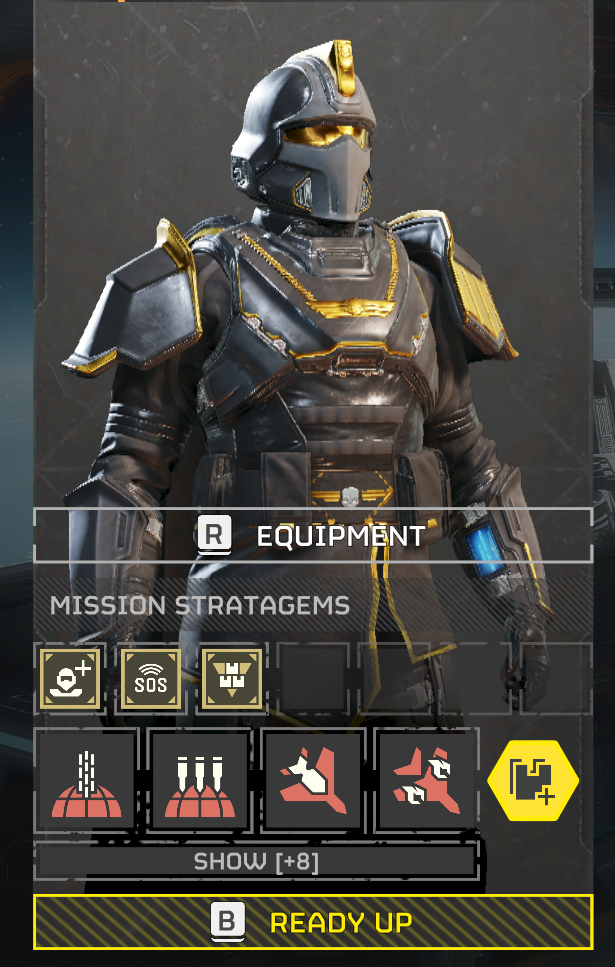
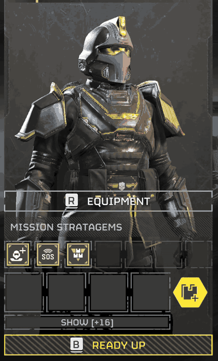
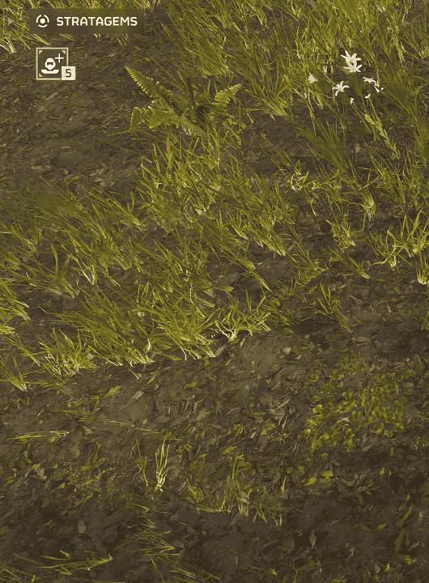

# More Stratagem Slots

<small>_Disclaimer: This was made using Claude Code. Opus 5.5 was used for the research and implementation, and Fable 5.2 was used for the planning._</small>

A mod for [HellForge](https://github.com/SkyeShade/HellForge) allowing you to bring up to a maximum of 20 stratagems. It reuses the existing stratagem widget on the loadout screen for seamless selection.

**Requires HellForge 0.4.0-beta or later. Built and tested on HellForge 0.4.0-beta and 0.5.0-beta, for game build 25480438. It has only been tested solo, so co-op is untested. If you try it, every player needs the mod.**

## Preview

<p>
  
  
  
</p>

<p>
  
  
</p>

## Installation

1. Download the latest release from the [Releases](https://github.com/hariyomari/more-stratagem-slots/releases/latest) page.
2. Open the HellForge launcher, go to the Mods page and press Add mods...
3. Pick the zip. You don't need to unpack it.
4. Make sure the mod is switched on, then start the game.

You can also drop the zip directly into your HellForge `mods` folder. That is the `mods` folder inside the folder HellForge is installed in, `%USERPROFILE%\Documents\HellForge\mods` by default.

## Usage

By default, you can press Q/E or MWHEEL UP/DOWN to scroll through the list of pages. If you have more than one page, the page you're on shows in the top right of the stratagem list, such as `1/3`.

The controls can be configured in the settings (see [Settings](#settings)).

On the loadout screen the slots are in rows of four. With 2 or more rows the card starts collapsed: it shows the first row, and a bar under it with the number of slots it hides (SHOW [+12] for 16 slots). Click the bar to show the other rows, and click it again (HIDE [-12]) to hide them.

## Settings

The settings are in `more-stratagem-slots.ini` in your HellForge `mods` folder, which is `%USERPROFILE%\Documents\HellForge\mods` with the default install location.

HellForge's sandbox (on by default) doesn't let mods create files, so you make the settings file yourself from the template that comes with the mod. Close the game first.

1. Open the folder HellForge is installed in, then its `mods` folder.

   

2. Open the mod's zip, which is also in this `mods` folder. Its name depends on where you downloaded it. Go into its `more-stratagem-slots` folder and copy `more-stratagem-slots.template.ini` from there into the `mods` folder. Rename the copy to `more-stratagem-slots.ini`, and it should now sit beside the mod's zip.

   

3. Open `more-stratagem-slots.ini` with a text editor, change a value and save. Changes apply the next time the game starts.

With the sandbox off, the mod creates `more-stratagem-slots.ini` with the defaults the first time the game starts with the mod switched on, and you can skip step 2.

| Setting             | Default | Description                                                                                                                                                                                             |
| ------------------- | ------- | ------------------------------------------------------------------------------------------------------------------------------------------------------------------------------------------------------- |
| `slots`             | `8`     | The number of stratagem slots in the loadout, from 4 to 20. See below the table for what 4 does.                                                                                                        |
| `collapse`          | `on`    | Collapses a loadout of many rows on the loadout screen (see [Usage](#usage)). With `off` the card always shows every row and has no bar.                                                                |
| `collapse_rows`     | `2`     | How many rows of four a loadout needs to be collapsed, from 2 to 5.                                                                                                                                     |
| `collapse_animate`  | `on`    | Opens and closes the collapsed rows over a moment. With `off` they show and hide at once.                                                                                                               |
| `page_prev`         | `Q`     | The key for the previous page, while the stratagem list is open. A letter, a digit, or a Windows virtual-key code.                                                                                      |
| `page_next`         | `E`     | The key for the next page.                                                                                                                                                                              |
| `page_wheel`        | `on`    | Allows the mouse wheel to switch pages while the stratagem list is open: wheel up is the next page and wheel down the previous one.                                                                     |
| `page_wheel_invert` | `off`   | Turns the mouse wheel around: wheel up is the previous page and wheel down the next one. Only takes effect with `page_wheel` on.                                                                        |
| `page_lock`         | `off`   | Stops you from switching pages while a stratagem is in your hand or being called in. With `off` you can switch at any time, and a stratagem in your hand stays in the list until it has been called in. |
| `page_added`        | `on`    | Puts stratagems that other mods add to your list during a mission (P.S.S. extras, for example) in the pages after your own. With `off` they stay on every page, which leaves less room for yours.       |
| `page_rearm`        | `on`    | Shows Eagle Rearm on every page once an Eagle has spent a use, so you can rearm from any page. With `off` it only shows on the pages that hold an Eagle. Either way it rearms the Eagles on every page. |

A settings file made by an older version doesn't have the newer settings, and the mod uses their defaults. To change one, add its line yourself (`page_rearm = off`, for example). Or, with the game closed, replace the file with a fresh copy of the template from the mod's zip, which has every setting. With the sandbox off, deleting the file is enough, and the mod writes a new one the next time the game starts.

The game's stratagem list holds 16 at most, including its own (Reinforce, Resupply, SOS Beacon and so on). When your stratagems don't fit, they are split into pages. Only the page shown can be called in, and each stratagem keeps its uses and cooldown while on another page.

With `slots = 4` the loadout screen stays the game's default, leaving only the paging. When other mods (P.S.S., for example) add stratagems to your list during a mission, those go into pages after your four, with the same keys.

### Upgrading from an older version

Since 0.3.2, `slots = 4` no longer switches the mod off. To turn the mod off, switch it off on the launcher's Mods page.

`per_row` and `page_hold` from older versions are no longer read, so you can delete their lines.

## Troubleshooting

### The settings file isn't there

HellForge's sandbox (on by default) stops the mod from making it, so you copy it from the template yourself. The steps are under [Settings](#settings).

### The game is stuck at "build mods"

The first time the game starts with a mod that is built from source, HellForge downloads its compiler. This can take a few minutes, and only happens once.

## Building

HellForge builds the mod from its source when the game starts, so you don't need to build anything to play. To make the release zip yourself, run `scripts\package.bat` (or `scripts/package.sh`) with your HellForge folder:

```powershell
.\scripts\package.bat $env:USERPROFILE\Documents\HellForge        # default HellForge install location
```

The zip is written to `dist`.

## License

[MIT](LICENSE)
