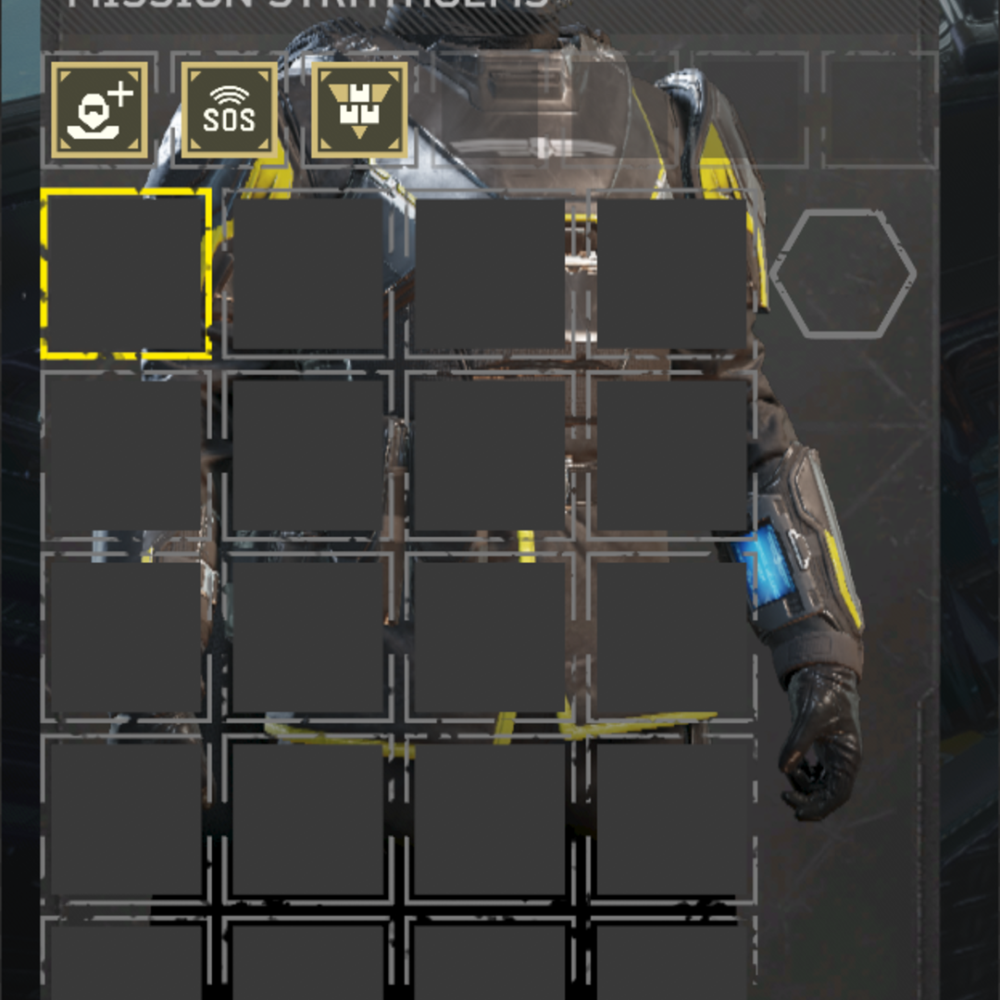
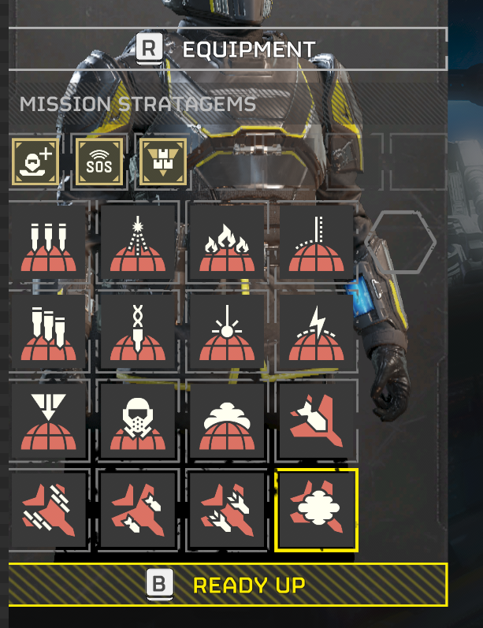

# More Stratagem Slots

<small>_Disclaimer: This was made using Claude Code. Opus 5.5 was used for the research and implementation, and Fable 5.2 was used for the planning._</small>

A mod for [HellForge](https://github.com/SkyeShade/HellForge) allowing you to bring up to a maximum of 20 stratagems. It reuses the existing stratagem widget on the loadout screen for seamless selection.

**Built and tested on HellForge 0.4.0-beta, for game build 25480438. It has only been tested solo, so co-op is untested. If you try it, every player needs the mod.**

## Installation

1. Download the latest release from the [Releases](https://github.com/hariyomari/more-stratagem-slots/releases/latest) page.
2. Open the HellForge launcher, go to the Mods page and press Add mods...
3. Pick the zip. You don't need to unpack it.
4. Make sure the mod is switched on, then start the game.

You can also drop the zip directly into your HellForge `mods` folder. That is the `mods` folder inside the folder HellForge is installed in, `Documents\HellForge\mods` by default.

## Usage

By default, you can press Q/E or MWHEEL UP/DOWN to scroll through the list of pages. If you have multiple pages, you should see `the current page number/the max page number` in the top right of the stratagem list.

The controls can be configured in the settings, which get auto-generated on the first launch after installing the mod.

## Settings

The settings are in `more-stratagem-slots.ini`, directly in your HellForge `mods` folder:

```
<your HellForge folder>\mods\more-stratagem-slots.ini
```

With the default install location that is `%USERPROFILE%\Documents\HellForge\mods\more-stratagem-slots.ini`. It sits beside the mod's zip, not inside the mod's own folder (the one with `hellforge-mod.json` and `src`).

1. Open the folder HellForge is installed in, then its `mods` folder:

   

2. The settings file is here, beside the mod's zip:

   

The file is created with the defaults the first time you start the game with the mod switched on. Open it with a text editor, change a value and save. Changes apply the next time the game starts.

| Setting      | Default | Description                                                                                                                                                                                             |
| ------------ | ------- | ------------------------------------------------------------------------------------------------------------------------------------------------------------------------------------------------------- |
| `slots`      | `8`     | The number of stratagem slots in the loadout, from 4 to 20.                                                                                                                                             |
| `per_row`    | `4`     | The number of slots per row on the loadout screen, from 4 to 20.                                                                                                                                        |
| `page_prev`  | `Q`     | The key for the previous page, while the stratagem list is open. A letter, a digit, or a Windows virtual-key code.                                                                                      |
| `page_next`  | `E`     | The key for the next page.                                                                                                                                                                              |
| `page_wheel` | `on`    | Allows the mouse wheel to switch pages while the stratagem list is open.                                                                                                                                |
| `page_hold`  | `on`    | Stops you from switching pages while a stratagem is being activated. With `off` you can switch right away, but the stratagem being activated will show the wrong name until it lands.                   |
| `page_added` | `on`    | Puts stratagems that other mods add to your list during a mission (P.S.S. extras, for example) in the pages after your own. With `off` they stay on every page, which leaves less room for yours.       |
| `page_rearm` | `on`    | Shows Eagle Rearm on every page once an Eagle has spent a use, so you can rearm from any page. With `off` it only shows on the pages that hold an Eagle. Either way it rearms the Eagles on every page. |

A settings file made by an older version doesn't have the newer settings, and the mod uses their defaults. To change one, add its line yourself (`page_rearm = off`, for example). Or delete the file while the game is closed, and the mod writes a new one with every setting the next time the game starts. The mod can't add to an existing file itself, because HellForge keeps the files in `mods` read-only while the game runs.

The game's stratagem list holds 16 at most, including its own (Reinforce, Resupply, SOS Beacon and so on). When your stratagems don't fit, they are split into pages. Only the page shown can be called in, and each stratagem keeps its uses and cooldown while on another page.

## Troubleshooting

### The settings file isn't there

The file is created the first time the game starts with the mod switched on. If it is missing:

1. Check on the launcher's Mods page that the mod is listed and switched on, and that your HellForge is up to date (the mod is tested on 0.4.0-beta). If the mod didn't start, it can't create the file.
2. Or create it yourself: copy [`more-stratagem-slots.template.ini`](more-stratagem-slots/more-stratagem-slots.template.ini) (it is also inside the zip) into the `mods` folder and rename it to `more-stratagem-slots.ini`. The template holds the defaults.

Don't edit the template where it is, or put the settings file inside the mod's folder: the mod only reads `mods\more-stratagem-slots.ini`.

### The game is stuck at "build mods"

The first time the game starts with a mod that is built from source, HellForge downloads its compiler. This can take a few minutes, and only happens once.

## Screenshots





## Building

HellForge builds the mod from its source when the game starts, so you don't need to build anything to play. To make the release zip yourself, run `scripts\package.bat` (or `scripts/package.sh`) with your HellForge folder:

```powershell
.\scripts\package.bat $env:USERPROFILE\Documents\HellForge        # default HellForge install location
```

The zip is written to `dist`.

## License

[MIT](LICENSE)
