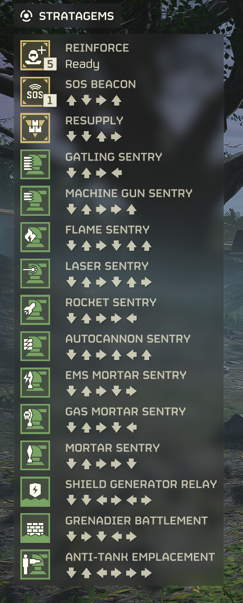

# More Stratagem Slots

<small>_Disclaimer: This was made using Claude Code. Opus 5.5 was used for the research and implementation, and Fable 5.2 was used for the planning._</small>

A mod for [HellForge](https://github.com/SkyeShade/HellForge) allowing you to bring up to a maximum of 20 stratagems. It reuses the existing stratagem widget on the loadout screen for seamless selection.

**This was made for game build 25480438. It has only been tested solo, so co-op is untested. If you try it, every player needs the mod.**

## Installation

1. Download the latest release from the [Releases](https://github.com/hariyomari/more-stratagem-slots/releases/latest) page.
2. Open the HellForge launcher, go to the Mods page and press Add mods...
3. Pick the zip. You don't need to unpack it.
4. Make sure the mod is switched on, then start the game.

You can also drop the zip directly into your HellForge `mods` folder.

## Usage

By default, you can press Q/E or MWHEEL UP/DOWN to scroll through the list of pages. If you have multiple pages, you should see `the current page number/the max page number` in the top right of the stratagem list.

The controls can be configured in the settings, which get auto-generated on the first launch after installing the mod.

## Settings

The settings are in `more-stratagem-slots.ini`, in your HellForge `mods` folder. It is created with the defaults the first time you start the game with the mod. Changes apply the next time the game starts.

| Setting      | Default | Description                                                                                                                                                                           |
| ------------ | ------- | ------------------------------------------------------------------------------------------------------------------------------------------------------------------------------------- |
| `slots`      | `8`     | The number of stratagem slots in the loadout, from 4 to 20.                                                                                                                           |
| `per_row`    | `4`     | The number of slots per row on the loadout screen, from 4 to 20.                                                                                                                      |
| `page_prev`  | `Q`     | The key for the previous page, while the stratagem list is open. A letter, a digit, or a Windows virtual-key code.                                                                    |
| `page_next`  | `E`     | The key for the next page.                                                                                                                                                            |
| `page_wheel` | `on`    | Allows the mouse wheel to switch pages while the stratagem list is open.                                                                                                              |
| `page_hold`  | `on`    | Stops you from switching pages while a stratagem is being activated. With `off` you can switch right away, but the stratagem being activated will show the wrong name until it lands. |

The game's stratagem list holds 16 at most, including its own (Reinforce, Resupply, SOS Beacon and so on). When your stratagems don't fit, they are split into pages. Only the page shown can be called in, and each stratagem keeps its uses and cooldown while on another page.

## Screenshots

